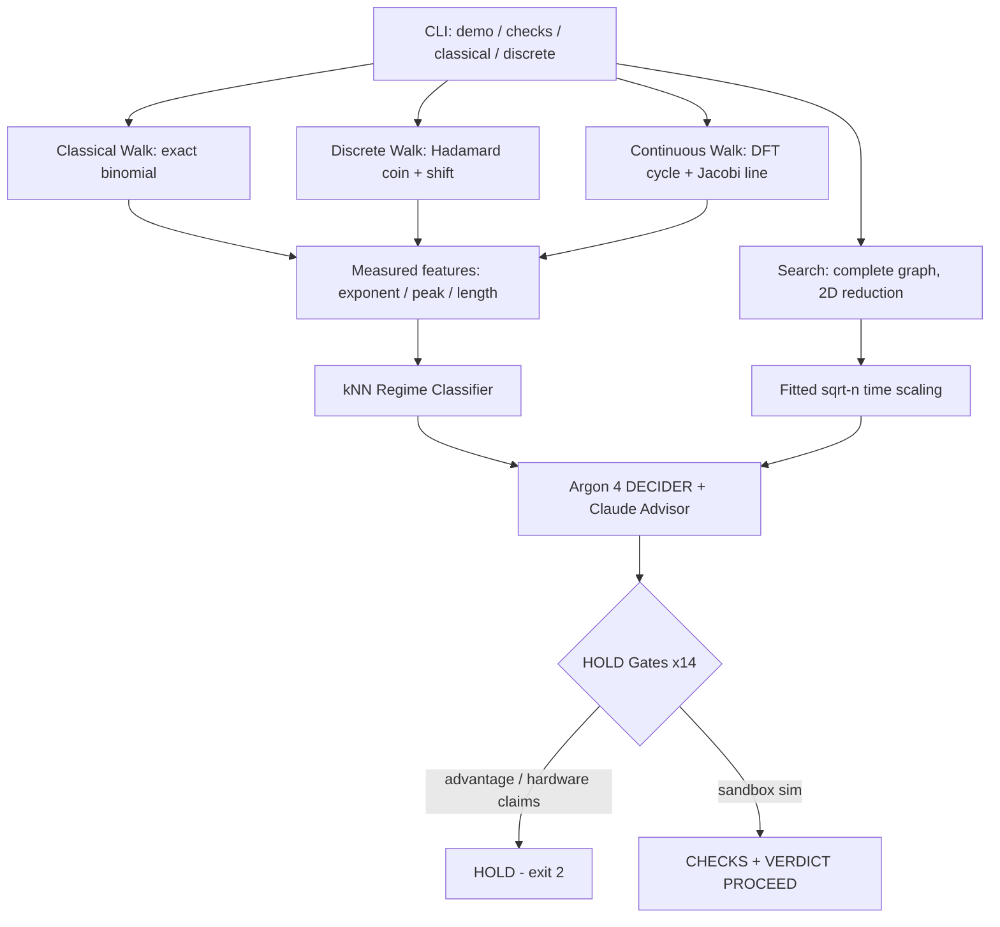
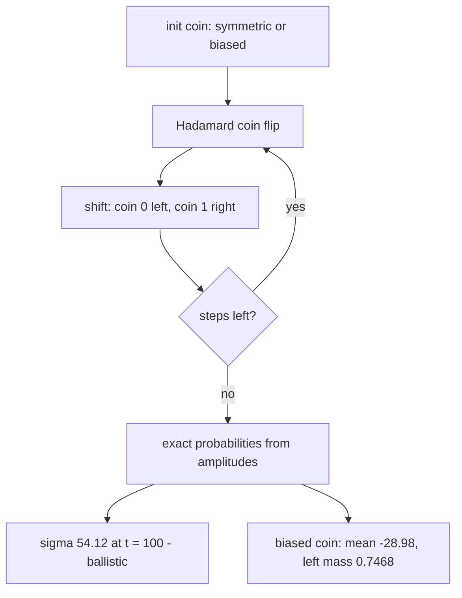
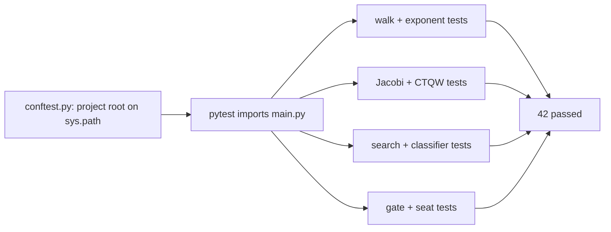
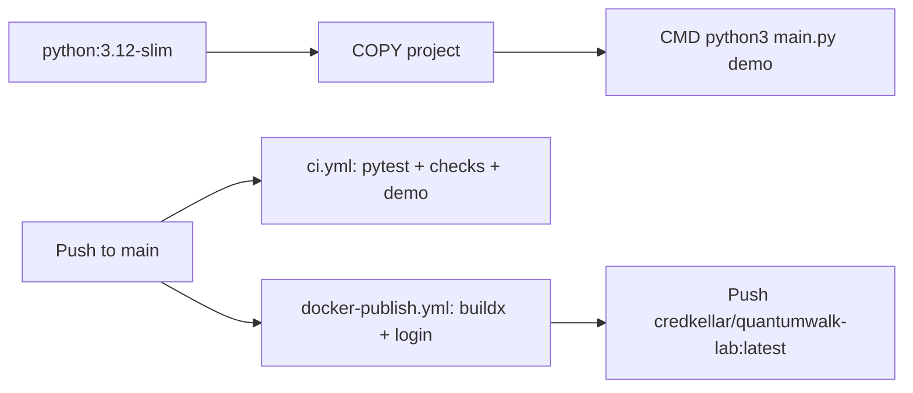

# QuantumWalk-Lab 🚶‍♂️⚛️

**Quantum Walk Lab — discrete + continuous walks vs the classical random walk** — by Darion Kellar

QuantumWalk-Lab is an **educational quantum-walk lab** in ONE pure-Python file. It puts the three walks side by side and lets the numbers argue:

- **Classical random walk** = a coin-flip stroll on a line: the exact binomial distribution, spreading **diffusively** — width ∝ √t. 🐢
- **Discrete-time quantum walk** = a Hadamard coin + shift on a statevector: amplitudes interfere, the middle empties out, and the walker spreads **ballistically** — width ∝ t. 🚀
- **Continuous-time quantum walk** = Hamiltonian evolution on a cycle and a line: perfect transfer, exact revivals, and the fastest spreading of the three — width = √2 · t. 🌊

Then the lab cashes the physics in: a **quantum-walk search** on a complete graph whose find-time grows like √n (fitted in-lab), against the (n+1)/2 expected draws of classical random sampling — labelled toy units, exponent first, hype last. A from-scratch kNN classifier reads each walk's measured width-growth exponent and names its regime: diffusive / ballistic / localized. 🔬

Honest scope, stated up front: every probability is computed **exactly** from amplitudes on a laptop — nothing is sampled, and nothing runs on quantum hardware. The search "advantage" is a scaling exponent inside a toy, **not** a claim about real algorithms or devices. Every advantage / hardware / supremacy / production claim sits behind a permanent HOLD gate (14 total). 🔒

[](https://github.com/kimanicollier44-cmyk/QuantumWalk-Lab/actions/workflows/ci.yml)
[](https://github.com/kimanicollier44-cmyk/QuantumWalk-Lab/actions/workflows/docker-publish.yml)

> ℹ️ These are the **live** workflow badges for this repo. They activate as soon as the `ci.yml` and `docker-publish.yml` files from the paste pack are pasted into `.github/workflows/` — until then they have nothing to report yet.

## 🧰 Tech Stack Badges & Full Architecture Tech Stack

### 💻 Core Programming Languages & Core Systems


- 🐍 Python 3.12, pure standard library (`math`, `cmath`, `hashlib`, `json`, `sys`) — zero dependencies, zero network, deterministic (double-run byte-identical)
- 🎲 Walk cores: exact binomial probabilities (`math.comb`), a Hadamard coin + shift statevector over position × coin, a DFT-diagonalised cycle walk, and a from-scratch cyclic **Jacobi eigensolver** for the line walk and the search Hamiltonian — every spectrum asserted before it is trusted
- 📈 Scaling fits: least-squares exponents on log–log axes, computed in-lab for every walk and for the search times
- 🧠 TinyML kNN regime classifier (from scratch, stdlib): diffusive / ballistic / localized from measured (exponent, peak ratio, length)
- 🪑 Council seats: Gemini Argon 4 Extended Thinking DECIDER (names-only, tighten-only) + Muse advisor (never overrides HOLD) + Google Flow plan-only (rendered = False, live = 0)

### ⛓️ Web3 & Infrastructure

- 🚫 **Not applicable — honestly.** No blockchain, no Web3, no tokens: the "infrastructure" in this lab is exact linear algebra inside one offline file. No fake badges here.

### ⚙️ Platform Support & Hardware Architecture


- 🖥️ Pure Python — runs anywhere Python 3.12+ runs (Linux, macOS, Windows), plus the `python:3.12-slim` Docker image
- 🔒 No quantum hardware is touched, ever: real QPUs, cloud quantum jobs, and device benchmarks are permanent HOLD gates (see the gate table below)

### ⚡ Low-Level Infrastructure & Performance

- 🚫 **No low-level code — honestly.** No C, no C++, no GPU, no compiled extensions: this is one interpreted Python file on purpose, so every amplitude can be read, checked, and diffed. Performance here means honest algorithms — exact statevector updates, an analytic DFT spectrum, and a Jacobi solver whose reconstruction error is asserted < 1e-9 before use.

### 🛠️ DevOps & Build Tools


- 🐳 Docker (`python:3.12-slim`), GitHub Actions CI + Docker Publish (delivered in the paste pack)
- 🎯 Target image: `credkellar/quantumwalk-lab:latest`
- 🧪 Tests: `pytest` (42 tests) + the built-in CHECKS suite (50 checks) in `main.py`

### ☁️ Cloud Providers

- 🚫 **None — honestly.** No cloud provider is used or needed: the lab runs fully offline on your own machine or in a local Docker container. Docker Hub appears only as the registry the publish workflow pushes the image to.

## What this does?

1. 🎲 **Classical walk, exact** — after t steps the walker sits at x = 2k − t with probability C(t, k)/2^t, computed with `math.comb`, never sampled. The variance is exactly t, so at 100 steps σ = **10.0000**, and the fitted width-growth exponent over t = 10…160 is **0.5000** — diffusion, pinned to its analytic value.
2. 🪙 **Discrete-time Hadamard walk** — a coin qubit is flipped by the Hadamard gate and the walker shifts left or right with the coin. Evolved as an exact statevector over position × coin, the symmetric start (|0⟩ + i|1⟩)/√2 stays centred but spreads to σ = **54.1241** at 100 steps — **5.41× wider** than the classical walk at the same step count.
3. 📈 **The ballistic rate, checked against theory** — the fitted exponent is **0.9989 ≈ 1**, and σ/t at 100 steps is **0.5412**, matching the known Hadamard-walk rate √(1 − 1/√2) = 0.5412 to four decimals. Interference empties the middle of the distribution and piles probability at two fronts near ±0.54 t.
4. 🎯 **The biased coin steers the walk** — start entirely in the left-moving coin state and the symmetric picture collapses: mean position **−28.98** at 100 steps, **74.68%** of the mass on the left half, the tallest peak at x = **−68** — while the width stays ballistic (exponent 0.99). The initial coin state is a steering wheel, and the lab shows its receipt.
5. 🌊 **Continuous-time walk on a cycle** — no coin at all: H = adjacency, diagonalised analytically by the DFT (eigenvalues 2cos(2πk/n)). On the 4-cycle the walker transfers **perfectly** to the opposite site at t = π/2 (P = 1.000000), revives fully at t = π, and the 6-cycle revives at t = 2π — periodicity asserted to 1e-9, with the return probability also matched to its closed form ((1 + cos 2t)/2)².
6. 🏃 **Continuous-time walk on a line** — the path graph's spectrum comes from a from-scratch Jacobi eigensolver (reconstruction V Λ Vᵀ = A asserted < 1e-9, and cross-checked against the DFT on a cycle). The packet spreads at σ = **√2 · t exactly** (1.4142 per unit time, exponent 1.0) — faster than the discrete Hadamard walk, because the packet rides the fastest modes.
7. 🔍 **Quantum-walk search, honestly labelled** — Childs–Goldstone search on the complete graph K_n (γ = 1/n): by symmetry the dynamics collapse to a 2D Rabi oscillation, solved exactly and **cross-checked against the full n × n Hamiltonian** at n = 8 (< 1e-9). The marked vertex peaks at P ≈ **1.0000** at t* ≈ (π/2)√n — n = 1024: t* = **50.272** vs **512.5** expected classical draws. The fitted time exponent over n = 16…1024 is **0.5000**. Toy units (1 walk-time = 1 oracle query) are printed wherever the comparison appears.
8. 🏷️ **Regime classifier + seats + checks** — a from-scratch kNN reads each walk's *measured* (exponent, peak ratio, length) and labels it: classical → diffusive, both Hadamard walks → ballistic, the shift-disabled trapped walk → localized, the CTQW line → ballistic — with Argon 4 DECIDER (sha256 trace), Muse advisor, Google Flow plan-only, and a built-in CHECKS suite (50 checks).

## 🗺️ How it works — diagram per script

### `main.py` — the whole lab



### Classical walk subsystem — exact binomial diffusion

```mermaid
flowchart LR
    A[steps t] --> B[C(t, k) / 2^t via math.comb]
    B --> C[distribution over x = 2k - t]
    C --> D[sigma: variance = t exactly]
    C --> E[fit exponent over t = 10..160]
    E --> F[0.5000 - diffusive]
```

### Discrete walk subsystem — Hadamard coin + shift



### Continuous walk subsystem — DFT cycle + Jacobi line

```mermaid
flowchart TD
    A[H = adjacency] --> B[cycle: DFT eigenvalues 2cos(2 pi k / n)]
    A --> C[line: Jacobi eigensolver]
    C --> D[assert V L V^T = A under 1e-9]
    B --> E[evolve amplitudes exp(-i lambda t)]
    D --> E
    E --> F[C4 transfer at pi/2, revival at pi]
    E --> G[line sigma = sqrt(2) t]
```

### Search subsystem — complete-graph spatial search

```mermaid
flowchart LR
    A[K_n, gamma = 1/n] --> B[symmetry: 2D span of marked + rest]
    B --> C[exact 2x2 Rabi oscillation]
    C --> D[cross-check vs full n x n at n = 8]
    D --> E[t* ~ (pi/2) sqrt(n), P near 1]
    E --> F[fitted exponent 0.5000 - labelled toy units]
```

### `tests/test_main.py` + `conftest.py` — verification



### `Dockerfile` + CI flow — container & publish



## Why is this cool?

1. 📈 The whole quantum-walk story is **one number**: classical width grows with exponent 0.5000, quantum with 0.9989 — and both exponents are *fitted from the lab's own distributions*, not printed from a textbook.
2. 🎯 The Hadamard walk's speed is checked against theory to four decimals: σ/t = 0.5412 measured, √(1 − 1/√2) = 0.5412 predicted.
3. 🪙 The biased-coin run is a steering demo with receipts: one different initial state and 74.68% of the walker ends up on the left, peak at x = −68 — interference as a control knob.
4. 🌊 The 4-cycle walk does something no classical walker can: it is **entirely** at the opposite site at t = π/2 and **entirely** back home at t = π — perfect transfer and revival, asserted to 1e-9.
5. 🏃 The continuous line walk outruns the discrete one — σ = √2 · t vs 0.5412 · t — and the lab shows both rates side by side so the coin's cost is visible.
6. 🔍 The search section earns its headline: the √n time scaling is *fitted* (exponent 0.5000 over n = 16…1024), and the fast 2D model is proven against the full Hamiltonian before it is believed.
7. 🧮 The Jacobi eigensolver is self-proving: V Λ Vᵀ rebuilds the adjacency to < 1e-9, and its cycle spectrum is cross-checked against the analytic DFT eigenvalues.
8. 🚫 Nothing is sampled. Every probability in the lab is exact amplitude arithmetic, so a rerun is byte-identical and every number can be re-derived by hand-checkable code.
9. 🏷️ The classifier closes the loop: it reads the *measured* exponents and sorts five real lab runs into diffusive / ballistic / localized with no hand-labelled answers.
10. 🔒 The honesty is load-bearing: toy units are printed inside the search table itself, and `quantum_advantage_claim` is HOLD gate #1 — the lab teaches the scaling without selling it.

## What problems this solves?

1. ❌ **Problem:** "Quantum walks are faster" is usually asserted, not shown. ✅ **Solution:** Both widths are computed exactly and fitted — 0.5000 vs 0.9989 — so the speed difference is a measurement, not a slogan.
2. ❌ **Problem:** Random-walk demos sample coins and call the histogram a distribution. ✅ **Solution:** The classical distribution is the exact binomial (C(t,k)/2^t) and the quantum one is exact statevector arithmetic; parity zeros and σ = √t hold to machine precision.
3. ❌ **Problem:** The Hadamard walk's σ ≈ 0.54 t rate is quoted without derivation. ✅ **Solution:** The lab measures 0.5412 and asserts it against √(1 − 1/√2) in CHECKS.
4. ❌ **Problem:** Initial-state effects get hand-waved as "the distribution is asymmetric". ✅ **Solution:** The biased run is quantified: mean −28.98, left mass 0.7468, peak at −68, exponent still 0.99.
5. ❌ **Problem:** Continuous-time walks are taught as magic exponentials of matrices. ✅ **Solution:** Two transparent diagonalisations — DFT for the cycle (with closed-form receipts) and a Jacobi solver for the line whose reconstruction error is printed by the checks.
6. ❌ **Problem:** Revival and perfect transfer sound like folklore. ✅ **Solution:** They are asserted numerically to 1e-9 at t = π/2, π, and 2π on C4 and C6.
7. ❌ **Problem:** Quantum search speedups are marketed from the Grover headline alone. ✅ **Solution:** The complete-graph walk search is built, its t* is measured at four sizes, the exponent is fitted at 0.5000, and the classical (n+1)/2 baseline is printed in the same table — with toy units labelled on the table itself.
8. ❌ **Problem:** Fast reduced models get trusted because they are fast. ✅ **Solution:** The 2D search model is cross-checked against the full n × n Hamiltonian at n = 8 to < 1e-9 before any large-n number is quoted.
9. ❌ **Problem:** "Diffusive / ballistic / localized" are vibes in most explainers. ✅ **Solution:** A kNN classifier over measured features assigns the regimes, and the trapped (shift-off) walk proves "localized" is a real measured category, not a label.
10. ❌ **Problem:** Simulation labs quietly imply hardware results. ✅ **Solution:** 14 named HOLD gates return exit code 2 for every advantage, hardware, supremacy, benchmark, or production claim, forever.

## How to install this?

1. 📋 Clone or download this project folder.
2. 🐍 Make sure Python 3.12+ is installed: `python3 --version`
3. ▶️ Run the full demo + checks (no arguments needed):

```bash
python3 main.py
```

4. 🧪 Run the test suite:

```bash
pip install pytest
python3 -m pytest -q
```

5. 🎛️ Try the other commands:

```bash
python3 main.py checks      # 50 built-in checks
python3 main.py classical   # exact binomial walk + fitted exponent
python3 main.py discrete    # Hadamard walk: symmetric + biased reports
python3 main.py continuous  # CTQW cycle transfer/revival + line rates
python3 main.py search      # complete-graph search peaks + scaling fit
python3 main.py classify    # kNN walk-regime classifier report
python3 main.py brains      # Argon 4 + Muse + Flow seats
python3 main.py holds       # list all 14 HOLD gates
python3 main.py hold-demo   # exits 2 - gated actions stay HOLD
```

6. 🐳 Or run it in Docker:

```bash
docker build -t credkellar/quantumwalk-lab:latest .
docker run --rm credkellar/quantumwalk-lab:latest
```

## Requirements

- 🐍 Python 3.12 or newer
- 📦 Dependencies: **none** (standard library only)
- 🌐 Network: **none** — fully offline
- 🧪 For tests only: `pytest`
- 🐳 Optional: Docker

## FULL project structure tree

```text
quantumwalk-lab/
├── main.py                  # the whole lab: classical walk, Hadamard walk, CTQW (DFT + Jacobi), complete-graph search, classifier, seats, HOLD gates
├── conftest.py              # puts the project root on sys.path for tests
├── tests/
│   └── test_main.py         # 42 pytest tests: walks, exponents, Jacobi, CTQW, search, classifier, gates, determinism
├── assets/
│   └── cover.png            # README cover image (2736 x 912)
├── Dockerfile               # python:3.12-slim, runs the demo
├── .gitignore               # __pycache__/, .pytest_cache/, *.pyc
└── README.md                # this file
```

> 📦 Delivered separately as paste packs (not in this tree): `.github/workflows/ci.yml` + `docker-publish.yml`, and the Docker Hub pack (100-char description, 350-char About, overview, categories).

## 🔒 HOLD gates — all 14, permanent

| # | Gate | What stays held |
|---|------|-----------------|
| 1 | `quantum_advantage_claim` | No quantum-advantage claim from a classical simulation of tiny walks |
| 2 | `real_quantum_hardware_execution` | No submitting walks to real quantum hardware or cloud QPUs |
| 3 | `quantum_supremacy_claim` | No quantum-supremacy or beyond-classical claims from a laptop sim |
| 4 | `cryptographic_attack_claim` | No using walk search to claim attacks on real cryptography |
| 5 | `production_algorithm_claim` | No production search, optimisation, or routing deployment claims |
| 6 | `certified_benchmark_claim` | No presenting lab timings or exponents as certified hardware benchmarks |
| 7 | `simulation_as_hardware_claim` | Simulated probabilities are never presented as measured hardware data |
| 8 | `publish_unverified_scaling_claim` | No publishing a scaling exponent this lab did not measure |
| 9 | `drug_discovery_claim` | No drug, materials, or chemistry discovery claims from walk toys |
| 10 | `financial_trading_claim` | No trading, market, or portfolio claims from walk simulations |
| 11 | `military_targeting_claim` | No military, targeting, or surveillance use of walk algorithms |
| 12 | `commercial_service_claim` | No commercial service or product claims from a lab model |
| 13 | `investment_claim` | No investment claims; a teaching sim is not a prospectus |
| 14 | `remove_human_override` | The human override is never removed |

🧑‍⚖️ **Council seats:** Gemini Argon 4 Extended Thinking — DECIDER (names-only, tighten-only, MAP → MODEL → STRESS → DECIDE, sha256 trace, `can_override_hold = False`) · Muse — advisor (`can_override_hold = False`) · Google Flow — plan-only (`rendered = False`, `live = 0`).

✅ **Verification:** pytest **42 passed** (project + clean copy) · built-in CHECKS **50/50** · double-run output **byte-identical** · `hold-demo` exits **2** · `main.py` **861 lines**, pure stdlib, zero network.

## 🧒 5th-grade English section

Imagine you are standing on a long line of stepping stones, flipping a coin to decide each step. 🪙

- If you flip a normal coin — heads, step right; tails, step left — you mostly wander near the start. After 100 flips you are usually only about **10 stones** away. Scientists say your spread grows like the *square root* of the number of flips. 🐢
- A **quantum** walker uses a magic coin that can be heads *and* tails at the same time. The two versions of you walk both ways at once, and where the versions meet they can cancel out or add up. The middle cancels — and the edges add up! After 100 steps the quantum walker is usually about **54 stones** away. Same number of steps, more than **5 times** farther. 🚀
- Start the magic coin already pointing left, and the walker mostly marches left — about 3 out of every 4 chance of being on the left side. The starting coin is like a steering wheel. 🎯
- On a **ring** of stones, the quantum walker can do a perfect trick: after just the right amount of time it is *completely* on the far side of the ring — and a little later, *completely* back home, like the walk rewound itself. 🔄
- Because quantum walkers spread out so fast, they can also *find* things faster: hide a treasure on one of about a thousand stones and the quantum search finds it in roughly 50 time steps where flipping coins and guessing would need about 500 tries. The steps are pretend steps on a computer — but the math pattern is real, and it is why scientists care. 🔍
- This project is a **pretend lab on a computer**. No real quantum machine was used. It helps you learn why a walker that can go both ways at once does not wander — it *races*. 💻

---

MIT © 2026 Darion Kellar · QuantumWalk-Lab — educational simulation only 🚶‍♂️
